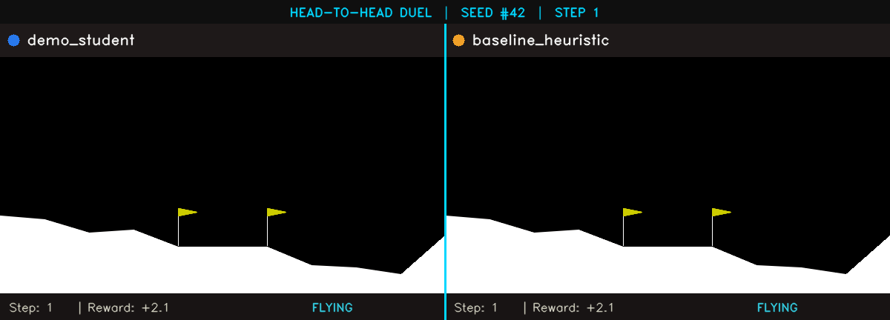

# 🏆 Reinforcement Learning Course — Official Class Tournament Leaderboard

Welcome to the automated competition leaderboard for the **Reinforcement Learning** course (Master in AI Applications, University of Alcalá).

All agents uploaded to GitHub are automatically benchmarked under identical conditions using fixed seeds and evaluated with **GitHub Actions**.

> **Last Updated:** `2026-10-15 13:25:41 UTC`  
> **Total Evaluated Agents:** `4`  
> **Evaluation Engine:** Automated CI Runner (`ubuntu-latest` / Python 3.10)

### 🌐 Interactive Arena and Web Viewer on GitHub
👉 **[OPEN THE INTERACTIVE ARENA (GitHub Pages)](https://gramuah.github.io/RL_tournament/)** 👈<br>
*Select any two agents and watch their head-to-head duel in synchronized video with landing-speed metrics and real-time telemetry.*

👉 **[Run an On-Demand Interactive Duel in GitHub Actions](https://github.com/gramuah/RL_tournament/actions/workflows/duel.yml)**<br>
*(Click "Run workflow" on GitHub to generate a custom duel with animation and an instant report).*

---

### 🎬 Live Replay: Head-to-Head Duel (*Split-Screen*)
Both agents start with the **same deterministic seed** (identical terrain, altitude, target, and wind):

<p align="center">
  
</p>

---

## 📌 Table of Contents
- [🌐 Interactive Arena on GitHub Pages](https://gramuah.github.io/RL_tournament/)
- [🚀 Lab 1: LunarLander-v3](#-lab-1-lunarlander-v3)
- [🚕 Lab 2: Taxi-v3 / Taxi-v4](#-lab-2-taxi-v3--taxi-v4)
- [📝 How to Submit Your Model](#-how-to-submit-your-model)
- [⚙️ Evaluation Criteria & Rules](#-evaluation-criteria--rules)

---

## 🚀 Lab 1: LunarLander-v3

In this challenge, agents learn attitude and thruster control to land a spacecraft safely on the lunar surface between landing flags.
- **Pass Threshold:** $\text{Mean Reward} \ge 100.0$
- **Mastery Threshold:** $\text{Mean Reward} \ge 200.0$ (Solved Benchmark)
- **Episodes Evaluated:** 30 episodes (Fixed Seeds)

| Rank | Participant | Mean Score | Std Dev | Success Rate | Min / Max | Status |
| :---: | :--- | :---: | :---: | :---: | :---: | :---: |
| 🥇 **1st** | [rafael_flor](submissions/lab1/rafael_flor) | **257.38** | ±23.07 | 100.0% | [215.8, 297.1] | MASTERY 🏆 |
| 🥈 **2nd** | *baseline_random (Baseline)* | **-177.12** | ±93.92 | 0.0% | [-406.4, -15.5] | NEEDS IMPROVEMENT ⚠️ |

---

## 🚕 Lab 2: Taxi-v3 / Taxi-v4

In this challenge, agents learn a tabular Q-learning policy to pick up and drop off passengers in a discrete gridworld.
- **Pass Threshold:** $\text{Mean Reward} \ge 4.5$
- **Mastery Threshold:** $\text{Mean Reward} \ge 7.0$
- **Episodes Evaluated:** 50 episodes (Fixed Seeds)

| Rank | Participant | Mean Score | Std Dev | Success Rate | Min / Max | Status |
| :---: | :--- | :---: | :---: | :---: | :---: | :---: |
| 🥇 **1st** | [rafael_flor](submissions/lab2/rafael_flor) | **7.07** | ±2.50 | 100.0% | [3.0, 12.0] | MASTERY 🏆 |
| 🥈 **2nd** | *baseline_random (Baseline)* | **-778.07** | ±122.58 | 0.0% | [-983.0, -256.0] | NEEDS IMPROVEMENT ⚠️ |

---

## 📝 How to Submit Your Model

Participating in the tournament is completely automated:

1. **Train your model in the lab notebook** (`unit1_uah_master.ipynb` or `unit2_uah_master.ipynb`).
2. Run the final packaging cell in the notebook. It generates your `agent.py` and model weights.
3. **Fork or branch this repository** and create your submission directory:
   ```bash
   # For Lab 1:
   submissions/lab1/<your_github_username>/
       ├── agent.py
       └── ppo-LunarLander-v3.zip

   # For Lab 2:
   submissions/lab2/<your_github_username>/
       ├── agent.py
       └── q-learning.pkl
   ```
4. **Open a Pull Request (PR)** targeting `main`.
5. **Instant Feedback 🤖:** GitHub Actions will automatically evaluate your agent and comment on your PR with your score card within 2 minutes!
6. **Leaderboard Update 🏅:** When your PR is merged, the official leaderboard above is automatically updated.

---

## 🎯 Tournament Scoring: Point Formulas

Points awarded in each environment are calculated as follows:

### 🌕 LunarLander-v2 / v3:
```
R = R_trajectory + 10 * N_legs - 0.3 * N_main - 0.03 * N_side + R_terminal
```
- **R_trajectory (+100 to +140 pts):** Moving from top to landing pad while reducing speed and tilt.
- **N_legs (+10 pts each):** Each leg touching the lunar surface.
- **N_main (-0.3 pts/frame):** Main engine fuel consumption.
- **N_side (-0.03 pts/frame):** Side thrusters fuel consumption.
- **R_terminal:** **+100 pts** for safe touchdown inside flags; **-100 pts** for a crash.

---

### 🚕 Taxi-v3 / v4:
```
R = 20 * 1_{delivered} - 1 * (steps) - 10 * (illegal_actions)
```
- **+20 pts:** Successfully delivering the passenger at the destination.
- **-1 pt / step:** Cost per step taken (rewarding shortest route).
- **-10 pts:** Penalty for each illegal pickup or drop-off attempt.
